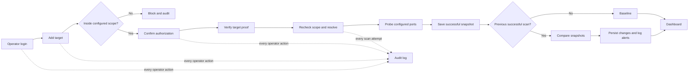

# AIORI PS-011 — Attack Surface Monitor

An authorized-only tool that inventories configured network services, saves scan snapshots, and highlights changes over time.

## The problem, in plain words

Teams need to know which services are exposed on systems they own and when that exposure changes. Think of this as a periodic, permission-gated walk around a building: record which doors are open, compare the notes on the next visit, and keep a log of who performed each check. This project performs bounded network discovery, not intrusion.

## Project Demo Video

Watch Full Project Demonstration on https://drive.google.com/file/d/1NMz1bmJDOgxq8gYlwgtK8UvwsAwFmOsY/view?usp=sharing

## How it works



## Features mapped to the problem

| Problem need | What the application provides |
|---|---|
| **Authorized** | Admin login, authorization acknowledgement and confirmation, and a nonce proof-file check before scanning by default. |
| **Inventory** | Real bounded TCP probes, short banners, light HTTP status/Server/title facts, and TLS certificate facts on server-configured ports. |
| **Change monitor** | Successful scans become snapshots. The first is a baseline; later successful scans are compared and changes are stored with both snapshot references. |
| **Accountability** | Sign-ins, target actions, and scan attempts are written to the audit collection; the dashboard offers a read-only audit view. |

## Security design choices

- `SCOPE_CIDRS` is the hard outer boundary. Empty scope means no address is allowed. Target creation and every scan are scope-checked.
- At scan time the application resolves hostnames, rejects the target if any answer is outside scope, and connects to validated numeric addresses.
- The target must be authorized and proof-verified when `REQUIRE_PROOF_BEFORE_SCAN=true` (the default).
- The server controls the probe port list. Probes use bounded timeouts, concurrency, delays, and response sizes; HTTP does not follow redirects.
- `SCAN_TLS_PORTS` and `SCAN_HTTP_PORTS` classify configured ports for certificate and light HTTP facts; they default to common service ports and can be set for a local lab.
- Audit is written before scan network activity; if the scan-start audit write fails, the scan is refused.
- Helmet uses a strict self-only script/style CSP. EJS dynamic values are escaped; styles are same-origin in `public/css/app.css`.
- The tool is discovery and monitoring only: no exploitation, brute force, or fuzzing.

## Screenshots

Screenshots can be added by the team:


## Evaluate in 5 minutes

1. Sign in and view the Overview checklist and configured scope.
2. In Inventory, add `127.0.0.1` with `127.0.0.1` as its IP and acknowledge authorization.
3. Confirm authorization. Copy the generated proof nonce into `.lab-data\proof.txt` using the PowerShell command below, then choose **Verify proof**.
4. Choose **Scan now** and refresh Inventory. The first successful scan is the baseline.
5. Run `npm run lab:open-port` and `npm run lab:swap-cert`, scan again, then inspect Changes and Audit.
6. Attempt to add `203.0.113.10` with that value as hostname and IP. It is outside the loopback scope, so the app blocks it before any probe and records the attempt.

See [docs/DEMO-SCRIPT.md](docs/DEMO-SCRIPT.md) for a timed click path.

## Quick start on Windows

Prerequisites: Node.js 20+, npm, MongoDB running locally or an accessible MongoDB Atlas URI, and Git for Windows (for OpenSSL used by the self-signed lab certificate).

```powershell
git clone <repository-url>
Set-Location .\A3-PS011-TC310
npm install
Copy-Item .env.example .env
```

Set these values in `.env` for the local demo:

```dotenv
MONGODB_URI=mongodb://127.0.0.1:27017/aiori_asm
MONGODB_DB_NAME=aiori_asm
ADMIN_USERNAME=admin
ADMIN_PASSWORD=<choose-a-strong-local-password>
SESSION_SECRET=<choose-a-unique-random-value-at-least-16-characters>
SCOPE_CIDRS=127.0.0.1/32
SCAN_PORTS=8080,8443,9100
PROOF_HTTP_PORT=8080
REQUIRE_PROOF_BEFORE_SCAN=true
```

Start the lab and app in separate PowerShell terminals:

```powershell
npm run lab
```

```powershell
npm start
```

Open `http://localhost:3000`. Once Inventory shows the target's proof nonce, place it in the loopback lab's proof file:

```powershell
Set-Content -NoNewline .\.lab-data\proof.txt '<nonce-shown-in-inventory>'
```

The package scripts are `npm start`, `npm run dev`, `npm run lint`, `npm test`, `npm run test:unit`, `npm run test:integration`, `npm run db:init`, `npm run lab`, `npm run lab:open-port`, `npm run lab:swap-cert`, and `npm run verify`. `npm run verify` runs lint, tests, and an automated local end-to-end flow; stop any manually started app/lab first.

## Tech stack and project structure

| Technology | Use |
|---|---|
| Node.js 20+ ES modules, Express | Application and routes |
| EJS | Escaped server-rendered pages |
| MongoDB and Mongoose | Targets, snapshots, changes, audit events, scan jobs, sessions |
| Zod, Helmet, express-session, connect-mongo, express-rate-limit | Validation and web security controls |
| Pino, ipaddr.js | Structured logs and IP/CIDR handling |
| Jest, Supertest, ESLint | Tests and lint |

| Path | Contents |
|---|---|
| `src/routes/` | Login, target, scan, audit, and dashboard route handlers |
| `src/services/` | Scanner, scope-aware resolution, diffing, changes, proof, audit, and scan locking |
| `src/models/` | Mongoose collections |
| `views/` and `public/css/` | EJS pages and same-origin stylesheet |
| `scripts/lab.mjs` | Loopback HTTP, HTTPS, proof, and optional TCP lab |
| `scripts/verify.mjs` | Automated end-to-end verification |
| `tests/` | Unit and integration tests |
| `docs/` | Evaluator, architecture, security, and demo documentation |

## Done vs Planned

| Capability | Status | Current implementation |
|---|---|---|
| Scoped authorized discovery and proof gate | Done | Scope gate, operator confirmation, proof verification, and real configured-port probes. |
| Snapshot inventory and change feed | Done | Successful snapshots, baseline comparison, and persisted change records. |
| Login, CSRF, strict CSP, and audit view | Done | Single configured admin account and read-only audit interface. |
| Loopback lab and automated verification | Done | `npm run lab*` and `npm run verify`. |
| Email alerts | Planned | Change alerts currently go to application logs. |
| Scheduled rescans | Planned | Scans are operator-triggered. |
| Export | Planned | No inventory or change export is implemented. |
| Distributed scan lock | Planned | Scan lock is process-local and does not coordinate multiple instances. |

## Legal and ethical use

Use this software only on systems you own or are explicitly authorized to assess. Configure the narrowest appropriate `SCOPE_CIDRS`. The application is intended for asset discovery and monitoring only and must not be used for exploitation, brute force, fuzzing, or scanning outside the authorized boundary.

AI assistance: [to be filled by the team]

Demo video: [link to be added]
