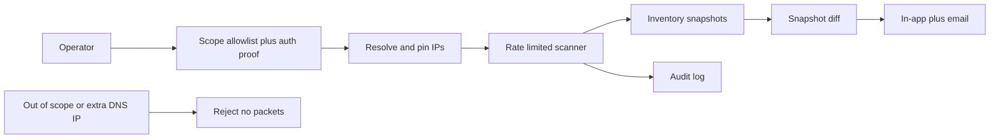

# Phase 1 — Problem analysis

**Status:** Approved (2026-10-10), with later edits for DNS/IP pinning, AIORI-3 process, and sprint end 14 Oct 2026 EOD.

**Why this phase exists:** lock *who it is for*, *what pain it removes*, and *what we will not build* before requirements or code. That keeps the project a SOC inventory/monitor, not an unscoped recon toolkit.

Official problem: AIORI-3 **PS-011** — Authorised Attack-Surface Inventory and Change Monitor (Cybersecurity track).

---

## Locked decisions

- **Primary user:** SOC / security analyst watching changes.
- **Stack:** Node.js backend + MongoDB + simple web dashboard + Docker Compose lab.
- **Demo target:** lab we own (Docker services). No public domain. Authorization = confirmed allowlist + optional lab proof file. Scanner refuses out-of-scope targets **in code**.
- **DNS/IP pinning (Must):** resolve hostnames; verify **every** resolved IP against the allowlist; connect **only** to those verified IPs. Re-check on every scan job. Unit-test the reject path with no connect.
- **Alerts:** in-app + email (Mailhog in lab).
- **Dashboard auth:** single admin from environment variables.
- **Discovery:** configured port list (lab ports + a small common set), HTTP/TLS facts. Not a 1–65535 demo. Web tech fingerprinting is not committed.
- **Demo story:** baseline scan → open a new port and change a cert on the lab → rescan → change alert. Then add an unauthorized target and show the block.
- **Timebox:** 2 students, 3 days, **~36 useful hours**, sprint end **14 Oct 2026 end of day** (same calendar day as AIORI Level 1). Faculty mentor is required by AIORI but is not a coding seat.

---

## Users

| Role | Job in this product | What they care about |
| --- | --- | --- |
| SOC analyst (primary) | Watch inventory and change feed | What is exposed, what changed, proof we only scanned authorized assets |
| Scope owner (demo operator) | Add lab targets, confirm authorization | Cannot accidentally scan the internet; confirmation is stored |
| Judge / mentor | Short live demo | Authorization story, before/after change, audit log |

Out of design: multi-tenant MSSP, CISO board packet, pentester exploit workflow.

---

## Pain points

1. **Inventories rot.** A wiki of domains/IPs is wrong the week after someone exposes a new port.
2. **Changes are silent.** New open port or cert swap often shows up as an incident, not a ticket.
3. **Unauthorized recon is easy to do by mistake.** Tools default to “scan whatever I typed.” A professional product fails closed.
4. **No audit trail.** Nobody can show who scanned what, when, under which authorization.

---

## What “good” looks like

1. Empty allowlist → zero packets to anything.
2. A target is not scannable until authorization is confirmed (actor + timestamp). Optional lab proof file (`/.well-known/...`). Out-of-scope host/IP is rejected in code.
3. Hostnames are resolved; **every** IP is checked against the allowlist; TCP/TLS goes only to verified IPs.
4. Baseline inventory: host, verified IPs, open ports from the configured list, TLS cert subject/expiry/fingerprint where TLS exists.
5. A second scan after a lab change produces stored diffs (new port, cert changed/expiry), not a raw scan dump.
6. In-app change list plus email (Mailhog counts).
7. Rate limits and an append-only audit log.
8. The UI cannot be used as a generic scanner against arbitrary IPs.

---

## Success criteria (hackathon Definition of Done)

- [ ] Operator logs in with env-configured admin credentials.
- [ ] Adding a target requires explicit authorization confirmation; scanner checks allowlist on every job.
- [ ] Out-of-scope hostname/IP fails clearly; **no connect** is attempted (unit-tested, including extra/unexpected DNS A/AAAA records).
- [ ] In-scope lab scan records hosts, verified IPs, open ports, TLS cert fields where HTTPS exists.
- [ ] Re-scan produces stored change events (new asset, new open port, cert changed/expired).
- [ ] Change appears on the dashboard; email is sent or the same body is logged if SMTP is down.
- [ ] Every scan attempt (allowed or denied) is audit-logged.
- [ ] Scan rate is bounded in config (max concurrent sockets, delay between ports).
- [ ] README states legal use; default config scans **nothing**.
- [ ] AIORI presentation PDF follows the 11-section organizer template; Level 1 GitHub/video steps complete by 14 Oct 2026.

---

## Out of scope (Won’t)

- Exploitation, PoCs, brute force, credential stuffing, DoS.
- Scanning third-party internet assets, bug-bounty programs, or “the college website.”
- 65535-port blasts with no backoff.
- Cloud control-plane inventory (AWS/Azure/GCP APIs).
- Host agents, EDR, packet capture.
- CVE/CVSS scoring, pentest reports.
- Multi-org tenancy, SSO, RBAC beyond one admin.
- Mobile app, WebSockets (polling is enough).
- DNS TXT ownership for the lab demo (no public domain).
- Live integration with AIORI IMN (JSON export may come later as Should).

Discovery may include banners and TLS metadata. That is identification, not attack.

---

## Capacity (2 people / 3 days)

Day 1: skeleton + scope gate + lab that can be scanned.  
Day 2: snapshots + port/TLS scan + diff + in-app changes.  
Day 3: email, hardening, README, **and** Level 1 PDF/video/GitHub (same deadline).

If Day 2 slips, Day 3 becomes “diff + dashboard + demo + organizer PDF,” and email degrades to logged alert + Mailhog if it already works.

**Work split (preview):** Person A — API, scope/authz, scanner, snapshots, diff, cron, audit. Person B — Compose lab, dashboard, email, README/demo script, slide PDF. Both own “cannot scan out of scope.”

---

## Constraints

- Fail closed: no scope, no scan.
- Gentle: config-driven concurrency; lab compose network by default.
- Evidence: snapshots you can diff; changes are first-class records.
